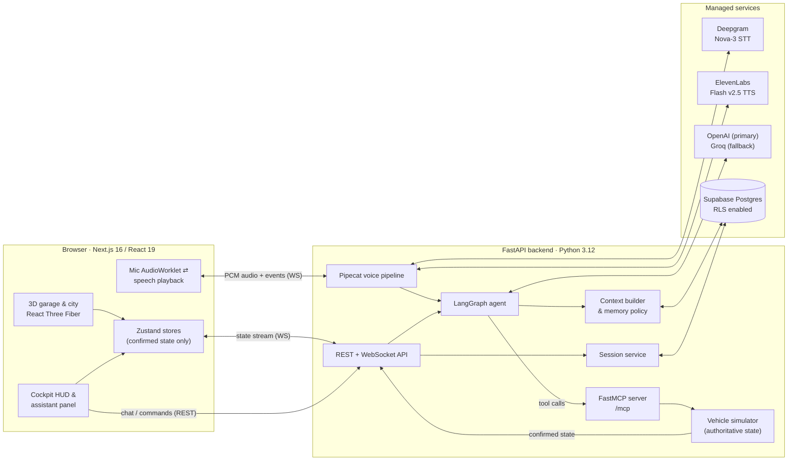
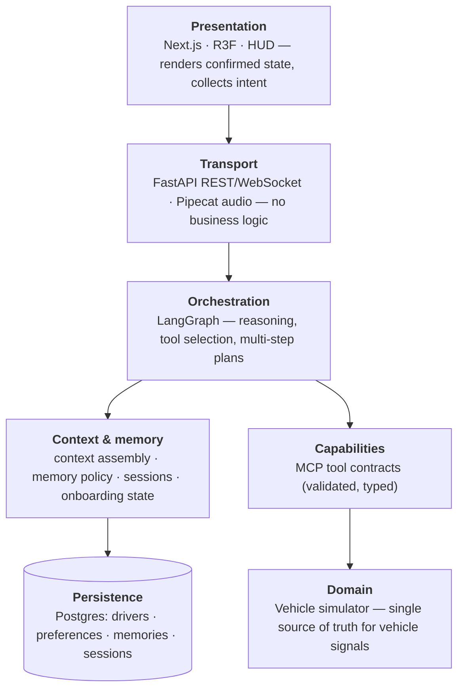
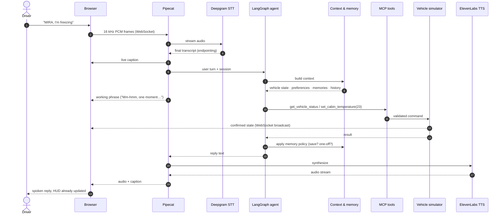
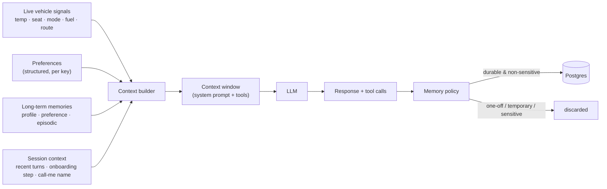
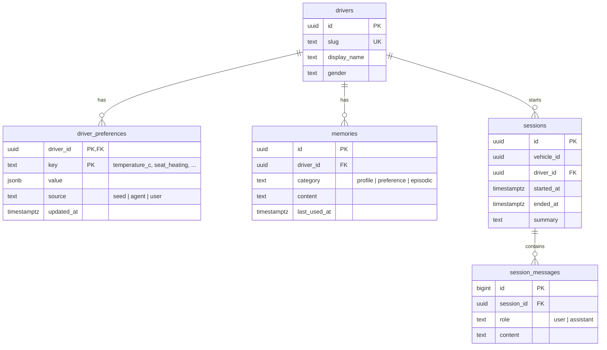
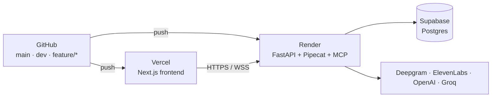

# MIRA — Memory-Informed Road Assistant

> A context-aware, voice-first in-car assistant that **gets to know each driver** and turns vehicle
> signals, conversation and history into personalised behaviour — built as an end-to-end reference
> architecture for agentic, memory-driven automotive AI.

**Demo video:** _add link_

 
 
 
 

---

## Table of contents

1. [Why MIRA](#1-why-mira)
2. [Demo walkthrough](#2-demo-walkthrough)
3. [System architecture](#3-system-architecture)
4. [A voice turn, end to end](#4-a-voice-turn-end-to-end)
5. [Context engineering & memory](#5-context-engineering--memory)
6. [Agent design](#6-agent-design)
7. [Vehicle simulator & MCP tools](#7-vehicle-simulator--mcp-tools)
8. [Data model](#8-data-model)
9. [Architecture decisions](#9-architecture-decisions)
10. [Security & privacy](#10-security--privacy)
11. [Quality & verification](#11-quality--verification)
12. [Repository layout](#12-repository-layout)
13. [Running locally](#13-running-locally)
14. [Deployment](#14-deployment)
15. [Limitations & roadmap](#15-limitations--roadmap)
16. [Credits & disclaimer](#16-credits--disclaimer)

---

## 1. Why MIRA

Most in-car assistants are stateless command parsers: *"set temperature to 21"* works, *"I'm freezing"*
does not, and nothing is learned between drives. MIRA explores the opposite design point:

| Capability | What it means in MIRA |
|---|---|
| **Context engineering** | Every turn is grounded in a curated context window: live vehicle state, the driver's preferences, relevant long-term memories, the current session and onboarding progress — and nothing else. |
| **Persistent, per-driver memory** | Profile, preference and episodic memory in Postgres, written through an explicit memory policy, isolated per driver, viewable and deletable by the user. |
| **Agentic tool use** | A LangGraph agent decides which vehicle capabilities to invoke; it can only act on the car through **MCP tools**, never by mutating state directly. |
| **Real-time voice** | A Pipecat pipeline streams microphone audio to Deepgram, runs the agent, and speaks back through ElevenLabs with barge-in and proactive announcements. |
| **An authoritative vehicle** | A simulator owns all vehicle signals, validates every command and broadcasts confirmed state; the UI never claims success before the car does. |

Since there is no physical vehicle, the car — its climate, seats, lighting, drive modes, music,
navigation, fuel and doors — is simulated behind the same MCP interface a real vehicle gateway would expose.

## 2. Demo walkthrough

1. Drag to walk around the car, click the dot on the driver's door, then **Get in**.
2. Pick **Daniel** or **Sophia** — MIRA "recognises" the driver (simulated) and sets the car up their way.
   A first-time driver gets a short getting-to-know-you conversation; say *"that's enough for now"* to skip it.
3. Press the mic and talk: *"MIRA, I'm freezing."* — she checks the cabin, compares it with your usual and adjusts.
4. *"Set it to 20 for now"* changes the car **without** touching your saved preference;
   *"I always like it at 21"* updates it.
5. *"Take me to Munich Airport."* — the garage door opens and the car drives itself through the city.
   **W A S D** takes the wheel at any time.
6. Leave, switch drivers and come back: preferences, nicknames and past trips are remembered.
   Open **Memories** in the assistant panel to inspect or delete what MIRA knows.

## 3. System architecture

### 3.1 Container view



### 3.2 Layered responsibilities



Each layer has exactly one owner, and the boundaries are enforced in code:

- **Pipecat never reasons** — it moves audio and hands text to the agent.
- **LangGraph never touches state** — it can only call MCP tools.
- **The simulator is the only writer** of vehicle state; the frontend renders what the backend confirms.
- **The memory policy is the only path to long-term memory** — conversation is not memory.

## 4. A voice turn, end to end



Latency budget per turn is dominated by the LLM call; the pipeline speaks a short, contextual
"working" phrase while tools run, supports barge-in, and pushes proactive messages
(arrival, low fuel) without a user turn.

## 5. Context engineering & memory

MIRA's core idea is that the **context window is engineered, not accumulated**. Each turn the
context builder assembles a compact, typed prompt from independent sources:



### Memory taxonomy

| Type | Storage | Example | Lifetime |
|---|---|---|---|
| **Profile** | `memories` (profile) | "Prefers to be called Dan" | Until deleted |
| **Preference** | `driver_preferences` (one row per setting) + `memories` | `temperature_c = 21` | Until changed |
| **Episodic** | `memories` (episodic) | "Drove to Munich Airport on 14 Nov" | Until deleted |
| **Session** | `sessions`, `session_messages` | The current conversation | One visit |
| **Working** | In-process | Tool results, live vehicle snapshot | One turn |

### Memory policy

- **Explicit beats remembered.** A current instruction always wins over a stored preference.
- **Temporary is not a preference.** *"for now"*, *"today"*, *"this trip"* change the car only.
- **Habits are proposed, not assumed.** Repeating the same setting makes MIRA *ask* to remember it.
- **No invention.** The agent may only mention names, preferences and memories that are in its context.
- **No sensitive data.** The policy refuses credentials and identifiers (passwords, PINs, card numbers, IBANs, social security numbers) and stores only stable facts the driver stated, never small talk or one-off requests.
- **Server-side onboarding state.** Getting-to-know-you progress lives in the session record, not in
  chat history, so questions are never repeated and the driver can stop at any time.

## 6. Agent design

- **LangGraph tool loop** with a single LLM call per command where possible; prompts are compact
  because tokens per minute, not requests, is the binding limit.
- **Model routing with failover:** OpenAI (`gpt-4.1-mini`, then `gpt-5-mini`) primary, Groq
  (`gpt-oss-20b`, `gpt-oss-120b`, `qwen3`) on errors or rate limits — transparent to the caller.
- **Intent → capability mapping:** moods map to cabin scenes (*"I'm exhausted"* → relax), and
  *"drive me to X"* sets the destination and starts the trip in one turn.
- **Human-sounding speech:** replies are written for the ear — short, with occasional natural fillers.
- **Testability:** the agent runs against a scripted model in tests, so tool selection, memory
  isolation and policy are verified deterministically without network calls.

## 7. Vehicle simulator & MCP tools

The simulator is the authoritative state machine for one virtual car per browser session.
Every command is validated (ranges, enums, preconditions), applied centrally, logged, and broadcast
to all connected clients. The agent sees it only through these FastMCP tools:

| Domain | Tools |
|---|---|
| Status | `get_vehicle_status` |
| Climate & comfort | `set_cabin_temperature`, `set_fan_speed`, `set_seat_heating`, `apply_cabin_scene` |
| Lighting & style | `set_ambient_lighting`, `set_paint_color` |
| Driving | `set_driving_mode`, `leave_garage`, `start_drive`, `stop_drive`, `refuel` |
| Navigation | `set_navigation_destination`, `cancel_navigation` |
| Media | `control_music` |
| Body | `set_window`, `set_door` |

Swapping the simulator for a real vehicle gateway (for example a VSS/KUKSA data broker) would
change the implementation behind these contracts, not the agent.

### HTTP & WebSocket API

| Method | Path | Purpose |
|---|---|---|
| `GET` | `/health` | Liveness |
| `GET` | `/api/drivers` | Demo drivers |
| `POST` / `GET` / `DELETE` | `/api/sessions[/{vehicle_id}]` | Start, read, end a driver session |
| `GET` | `/api/sessions/{vehicle_id}/profile` | Preferences + memories of the current driver |
| `DELETE` | `/api/sessions/{vehicle_id}/memories/{id}` | User deletes a memory |
| `PUT` | `/api/sessions/{vehicle_id}/preferences/{key}` | User saves a preference |
| `GET` / `POST` | `/api/vehicles/{vehicle_id}[/commands]` | Read state / validated command |
| `WS` | `/ws/vehicles/{vehicle_id}` | Confirmed state stream |
| `POST` | `/api/assistant/chat` | Typed conversation turn |
| `WS` | `/ws/voice/{vehicle_id}` | Real-time voice session |
| `POST` | `/api/voice/speak` | One-off speech synthesis |
| — | `/mcp` | FastMCP server (streamable HTTP) |

## 8. Data model



Preferences are deliberately **structured** (one typed row per setting, with provenance in `source`),
while memories are short natural-language facts. Row Level Security is enabled on every table with no
browser access; all personal-data queries are scoped server-side to the driver bound to the session.

## 9. Architecture decisions

| # | Decision | Rationale | Trade-off |
|---|---|---|---|
| 1 | **MCP as the only path to the vehicle** | A standard tool contract decouples reasoning from the car; the same tools serve the agent, tests and future clients. | Extra hop vs. calling the simulator directly. |
| 2 | **Simulator owns all vehicle state** | One source of truth, validated mutations, consistent multi-client sync. | Frontend must wait for confirmation before showing changes. |
| 3 | **Structured Postgres memory before vectors** | Preferences are keyed facts; SQL is exact, auditable and editable by users. pgvector is added only when semantic recall measurably helps. | No fuzzy recall over large free-text histories yet. |
| 4 | **Context built per turn, not chat-history-driven** | Bounded tokens, deterministic grounding, no drift from long histories. | The builder must decide what is relevant. |
| 5 | **Pipecat for transport, LangGraph for reasoning** | Voice concerns (VAD, streaming, barge-in) stay separate from agent logic; typed chat and voice share one agent. | Two runtimes to integrate. |
| 6 | **Deepgram STT + ElevenLabs TTS** | Low-latency streaming recognition; a warmer, more natural voice. `TTS_PROVIDER=deepgram` switches back. | Two vendors, two quotas. |
| 7 | **Multi-provider LLM failover** | Free-tier rate limits must not break a live voice turn. | Slight behavioural variance between models. |
| 8 | **Server-side session & onboarding state** | Progress survives detours and reconnects; the model does not have to infer it from history. | More state in the session record. |
| 9 | **Simulated driver recognition** | Privacy-first MVP: no camera, no biometrics, same downstream flow. | Real recognition is future work. |

## 10. Security & privacy

- Secrets live only server-side (`.env`, platform env vars); nothing private uses a `NEXT_PUBLIC_` prefix.
- Supabase RLS on every table; the public key receives 401 on all tables.
- Every MCP tool argument and REST command is validated with Pydantic; invalid operations are rejected.
- Driver isolation: memories and preferences are only ever loaded for the driver bound to the session.
- Users can view and delete their memories from the UI.
- Per-visitor rate limits protect paid APIs on the public demo.
- No webcam images, no biometric templates.

## 11. Quality & verification

| Area | Coverage |
|---|---|
| Backend (pytest, **67 tests**) | Simulator state transitions, REST & WebSocket API, MCP tools, agent tool selection with a scripted model, memory isolation & policy, temporary-vs-durable settings, onboarding flow, session lifecycle, LLM failover, voice protocol & TTS factory, rate limits |
| Frontend (Vitest, **15 tests**) | Camera framing, garage state, city routing, habit detection |
| Static checks | TypeScript strict, ESLint (incl. React Compiler rules), production build |
| End to end | Verified in a real browser on the public deployment, including voice turns through Deepgram → agent → ElevenLabs |

```bash
cd backend  && uv run pytest
cd frontend && npx tsc --noEmit && npm run lint && npm test && npm run build
```

## 12. Repository layout

```text
MIRA/
├── frontend/                     Next.js app
│   ├── src/components/           garage · world · vehicle · cockpit · assistant · driver
│   ├── src/stores/               Zustand stores (vehicle, driver, voice, assistant, garage)
│   ├── src/lib/                  API & voice clients, city/route generation, habit detection
│   └── scripts/build-car-model.mjs   glTF pipeline (debranding, WebP, meshopt)
├── backend/                      FastAPI service (uv, src layout)
│   └── src/mira_backend/
│       ├── api/                  REST & WebSocket routes
│       ├── agent/                LangGraph graph, tools, LLM routing
│       ├── services/             simulator, sessions, preferences, briefing, repository
│       ├── vehicle_mcp/          FastMCP server
│       ├── voice/                Pipecat pipeline, wake word
│       ├── models/               Pydantic domain models
│       └── core/                 configuration, rate limits
├── supabase/                     migrations & seed data
└── docs/                         deployment & development notes
```

## 13. Running locally

```bash
# backend — Python 3.12 + uv
cd backend
cp .env.example .env                       # OpenAI/Groq, Deepgram, ElevenLabs, Supabase
uv sync
uv run python scripts/migrate.py           # tables + demo drivers (optional: omit DATABASE_URL for in-memory)
uv run python -m mira_backend.devserver    # http://127.0.0.1:8000  (OpenAPI docs at /docs)

# frontend — Node 24
cd frontend
cp .env.example .env.local
npm install
npm run dev                                # http://localhost:3000
```

`uv run python scripts/reset_demo.py` restores the demo drivers' seed preferences.

## 14. Deployment



Feature branches merge into `dev` through pull requests; stable releases are promoted to `main`.
Configuration is environment-based; see [`docs/development/deployment.md`](docs/development/deployment.md).

## 15. Limitations & roadmap

- **Real vehicle signals:** replace the simulator behind the MCP contracts with a VSS / KUKSA data broker.
- **Semantic memory:** add pgvector retrieval and memory consolidation once histories grow.
- **Memory from signals:** learn from implicit behaviour (time of day, routes, weather) in addition to speech.
- **Agent-to-agent (A2A):** delegate to specialised agents (navigation, charging, calendar).
- **Real driver recognition:** consent-based, on-device face recognition with confidence thresholds.
- **Evaluation:** an offline eval set for tool selection and memory decisions across models.

## 16. Credits & disclaimer

- 3D car model: ["BMW M2 g87 [Free]"](https://sketchfab.com/3d-models/bmw-m2-g87-free-125412579b244790b27b2a7839527c6e)
  by Black Snow, licensed under [CC BY 4.0](https://creativecommons.org/licenses/by/4.0/).
  Modified for MIRA: manufacturer badges and interior logos removed, hidden drivetrain parts dropped,
  geometry and textures compressed (`frontend/scripts/build-car-model.mjs`).

**Author:** Allabakash Ghodesawar · [GitHub](https://github.com/baksh07) · [LinkedIn](https://www.linkedin.com/in/allabakash-g)

MIRA is an independent portfolio project. It is not affiliated with, endorsed by, or officially
associated with BMW. All vehicle signals and interactions are simulated.
